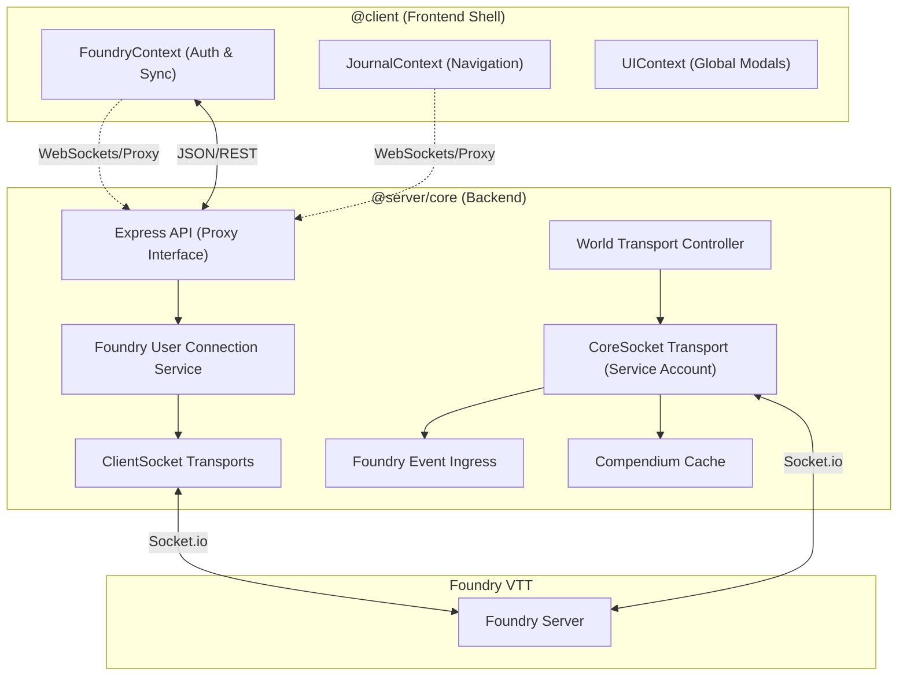

# SheetDelver System Architecture

This document serves as the authoritative source of truth for the SheetDelver architecture. It describes the design principles, structural organization, and decoupled "Core/Shell" model.

## 1. Architectural Philosophy
SheetDelver is designed as a **Headless Client Proxy** for Foundry VTT. It follows a "Clean Architecture" approach, strictly separating business logic from delivery mechanisms.

### Core Principles
- **Dual-Socket Model**: The backend maintains a permanent **System Client** for global world monitoring and a transient **User Client** pool for individual player sessions.
- **Frontend Agnosticism**: The Frontend (UI) never communicates with Foundry directly. It interacts solely with the SheetDelver API.
- **Context-Driven State**: The UI uses React Contexts as the single source of truth, synchronized via real-time WebSockets (Socket.io) to the Backend API.
- **Player-page canvas**: The player layout owns one world-artwork loader. Shared CSS provides viewport-fixed backgrounds to dashboard, combat, future routes and SDK-hosted sheets/tools; optional module CSS color and the current player-theme canvas supply fallbacks. See [ADR-0070](adr/0070-module-tool-backgrounds.md).
- **Client-Owned Presentation**: Module theme functions are loaded through the selected UI manifest, not JSON status or server adapter imports. Core applies the matching module CSS scope to its shared chat and dice controls. See [ADR-0044](adr/0044-client-owned-module-presentation.md).

---

## 2. Hardened Environment Model (4-Folder Root)

To ensure stability and prevent environment pollution (e.g., Node.js leaks in the browser), SheetDelver enforces a strict **Logic Firewall** via its directory structure:

- **`src/client` (`@client`)**: Pure frontend code. Contains UI components, React hooks, and browser-safe services. Strictly forbidden from importing Node.js globals (`fs`, `path`, `process`).
- **`src/server` (`@server`, `@core`)**: Pure backend code. Contains the Express API, service orchestration, server-owned Stores, and direct Foundry socket transports.
- **`src/shared` (`@shared`)**: Environment-agnostic logic. Contains interfaces, constants, and pure utilities (math, string parsing) safe for both environments.
- **`src/modules` (`@modules`)**: Module registry, lifecycle, distribution, and runtime loading infrastructure. Author-owned system modules live under the configured data directory, not in the source tree.

---

## 3. Decoupled Core/Shell Model

### 3.1 The Core Description (Server-Only)
- **Foundry User Connection Service (`src/server/services/foundry`)**:
    - Owns upstream Foundry user connection lifecycle and maps API tokens to `ClientSocket` transports.
    - Resolves Foundry user identity before creating a user transport; app-admin/backend sessions remain separate under `src/server/security`.
- **World Transport Controller (`src/server/services/world/WorldTransportController.ts`)**:
    - Owns service-account lifecycle policy: retry/backoff, heartbeat, browser engagement wakeups, world launch/shutdown, and lifecycle Store updates.
    - Commands `CoreSocket` as a transport; it does not live in `core/`.
    - ADR-0064's role gate, shipped in Core 0.19.0, requires the configured service account to be
      full Gamemaster on connect/reconnect and while active. This lifecycle policy
      blocks world access and gives admin recovery guidance; it does not change
      ordinary user/Assistant permissions.
    - A socket interruption gates world APIs but retains the last ready runtime. Affirmative, corroborated setup or explicit shutdown retires it; the controller alone reconnects the service-account socket.
- **Foundry Event Ingress (`src/server/services/world/FoundryEventIngress.ts`)**:
    - Subscribes to neutral Foundry socket events and applies application semantics such as document routing, user presence, and runtime teardown. `SharedContentIngress` receives selected media through each authenticated user session; `AppSocketGateway` forwards the matching Store projection.
- **Foundry Sockets (`@core/foundry/sockets`)**:
    - **CoreSocket**: A singleton service-account transport. Emits protocol facts and raw dispatch helpers; controller/ingress services own policy and Store mutation.
    - **ClientSocket**: A per-user transport. Receives neutral Foundry protocol events and performs user-authorized writes after identity is resolved by services.
- **Compendium Store / Discovery Shards**: Centralized services cache broad pack indices for name lookup and module-declared hydrated shards for compendium UUID document reads. Live Foundry pack-document fallback is diagnostic opt-in only.
- **Primary Document Cache**: Server-owned stores under `src/server/core/documents/primary/` that keep hydrated Foundry primary documents available after bootstrap. Actors are currently seeded through `ActorStore`; additional primary document types should join this area behind the same coordinator pattern.

### 3.2 The Delivery Layers
- **Server (`src/server`)**:
    - **Status Handler**: Aggregates data from both the System Client and the specific User Client to provide a complete view of the world state.
    - **Server file logging**: The existing logger can append plain-text output
      to separate, owner-only manager and Core files under `<DATA_DIR>/logs`.
      `debug.file-level` controls file output independently of console
      `debug.level`. The service manager or operating system owns rotation;
      no browser or module receives direct file access.
    - **Smart Proxy Socket**: Multiplexes individual Foundry connections to the frontend via a unified Socket.io interface.
    - **Module Routing**:
        - **API**: RegEx-based routing allows system-specific packages to mount their own API logic dynamically.
        - **UI**: The core actor page delegates rendering to the module's registered `ActorPage`, ensuring full UI autonomy.
    - **Shared Content**: `SharedContentStore` retains one latest share per authenticated session and world, populated only from that user's Foundry socket for the session lifetime, including gaps between browser connections. Opaque stream IDs and receipt sequences order HTTP snapshots and realtime emits; a late snapshot cannot supersede newer delivery or retirement. Service-account receipts are not public broadcasts. Terminal session/world teardown clears the scope; no persistent share history is introduced.

### Maintenance and the admin interface

During module maintenance, the supervisor replaces ordinary Core with its
restricted migration composition. The regular Next admin route group stays
available with its existing login, session cookies and `/api/admin` proxy.
Player navigation is stopped by the server proxy before rendering and shows
only “SheetDelver is in maintenance” in a styled box. Existing player sessions remain fenced by
Core. Admin attention and exact-plan/recovery controls live inside the normal
Modules panel; there is no separate maintenance login application. This is the
[CR64-27 correction](adr/0064-module-world-context-and-data-migrations.md#cr64-27-normal-admin-access-during-maintenance--october-18-2026)
to the earlier standalone-shell design, accepted by the operator and released in
Core 0.19.3.

The Next proxy imports only `MaintenanceRecord.ts`, a read-only parser and gate
predicate with an explicit runtime file path. Core's `MaintenanceMode.ts` wraps
that same reader with initialized path defaults and process-local progress;
directory setup, durable writers and runtime leases stay outside the proxy's
dependency graph. This keeps runtime data out of application dependency tracing
without duplicating validation or changing maintenance admission (CR64-28).

### 3.3 World-Ready Bootstrap Gates

`SystemService.bootstrap()` blocks world readiness on the data the platform needs before serving user workflows:

1. Module discovery and compendium hydration from each module's `info.json`.
2. Primary document seeding through `PrimaryDocumentCacheCoordinator.seedAll()`.
3. Active module adapter initialization.

A failed bootstrap/recovery is projected as `system.status: unavailable` with
`initialized: false`, rather than an endless startup. The owning bootstrapper
retains an admin-only phase/reason/remediation; reset or a new attempt retires it.
The existing admin world-preparation panel provides diagnosis and retry. Player
pages show a static maintenance/unavailable notice without diagnostic details;
protected readiness remains necessary to resume. See ADR-0064 CR64-30.

Per ADR-0022 and ADR-0023, `SystemService` lives at `src/server/services/world/SystemService.ts` (relocated from `core/system/`) so the orchestration facade sits alongside `WorldBootstrapper`, `WorldTransportController`, `FoundryEventIngress`, and `EngagementService`. `core/` never imports `services/`.

For actors, the platform performs one system-client fetch during bootstrap, seeds `ActorStore`, and then keeps that store in parity through Foundry event ingress (`modifyDocument` results and broadcasts). Actor API reads and dashboard card projections should read from this platform cache; they should not repeatedly ask Foundry to rehydrate the same actor list.
Pack-scoped Actor reads remain outside `ActorStore`: the initiating pack scope
survives terse/null acknowledgements, and neither socket ingress nor the
requesting repository mirrors pack results into primary world Stores.
Unsolicited read broadcasts also never mutate primary Stores. Only confirmed
world reads and document changes may refresh the world cache.

Pack index/freshness/hydration strategies carry the Store's native document type
(or explicit declaration when native metadata is unavailable), not pack-name
guesses when authority exists. Failed reads never become authoritative empty
freshness results; successful empty arrays/envelopes remain valid. Current
metadata/content revisions fence awaited publication. Route/SDK caller checks
still precede and follow reads, including warm-cache revocation; raw native
transport access is not a permission grant.

Migration plan/journal bulk I/O is owned by one serialized storage worker per
Core process. Immutable digest-addressed bundles reduce small-file/fsync fanout;
approval and native intent still await durable storage. The supervisor drains and
joins the worker before normal-runtime exit; cancellation retires it before any
replacement. Cached maintenance status/review is diagnostic only. See
[maintenance storage/recovery](MAINTENANCE_RUNTIME.md) for compatibility and
durability details. Lease and final-send metadata fences remain Core-owned.

First approval uses a durable provisional publication record tied to the exact
maintenance operation, plan, principal and lease, not an early authoritative
job reference. Only a confirmed durable job can be bound before promotion.
Cancellation/startup join the old writer and reconcile publication independently
of an aborted computation signal. An unpublished intent can be cancelled after
proven drain; a lost acknowledgement retains the exact approval. Missing/corrupt
previously bound jobs remain gated. Recovery re-syncs visible metadata before
binding; it does not authorize new repairs or replay writes (CR64-21).

On a same-world reconnect, `WorldBootstrapper.recover()` verifies world/system identity, refreshes the world snapshot and all active primary-document Stores, and rebuilds prepared actors without reinitializing the module adapter. Browser-visible changes are calculated from the snapshot captured at transport loss and published after readiness; Stores reject a seed that raced with a live mutation. A changed world/system still tears down and bootstraps anew. See ADR-0056.

---

## 4. Frontend Architecture

### 4.1 React Contexts
- **FoundryProvider**: Coordinates connection-step presentation and authorized world data from the shared realtime and session providers; it does not treat public status as authentication.
- **JournalProvider**: Manages journal entry loading, folder hierarchies, and pagination logic.
- **UIProvider**: Manages global overlay state. One layout-owned shared-content host presents images and delegates authorized journal reads to `JournalModal`; module-mounted compatibility components are inert to avoid duplicate overlays.
  Optional SDK footer registrations reserve measured visible bottom-bar space
  for Core chrome. SDKProvider releases its module/world/user registrations;
  terminal UI reset clears the host registry. Modules register only their own
  element via the public client SDK, never Core DOM or server-side layout state.
  Native journal sharing has a separate recipient/receipt-bound read-only lease
  and whitelisted JournalStore projection. Source ownership and ordinary reads
  remain unchanged; Secret content is filtered server-side for non-owners.
  Leases are modal-owned and bounded in the existing scoped SharedContentStore,
  not a persistent permission store (ADR-0062 J1).
  Ordinary journal detail and SDK embedded UUID reads additionally use one
  page-ownership projection: non-owners receive filtered display HTML without
  alternate Markdown source; page owners retain raw source for editing. Store
  source is never redacted. The rich editor preserves Secret wrappers on edits
  and original source on unchanged saves (ADR-0063).
- **PlayerWorldBoundary**: The player layout owns login/setup/closed/loading
  presentation for home, Actor and module-tool routes. Cold routes do not mount
  their page effects or persistent tools until authenticated readiness. A
  prior-ready same-world page and its tools remain mounted but inert behind one overlay during a transient outage;
  terminal world/session/user changes retire it. A protected, non-cacheable
  session read confirms the current cookie and user ID before unblocking, and
  Core remains the authority for every HTTP and socket action. See
  [ADR-0057](adr/0057-core-player-world-state-boundary.md).
  Restoring the cookie-session marker keeps an already authenticated socket.
  Protected readiness immediately reconciles the latest status instead of
  waiting for another heartbeat. FoundryProvider owns initial/reconnect Actor
  and combat reads; ChatProvider owns chat. See
  [ADR-0065](adr/0065-player-startup-and-module-styles.md).
- **ChatProvider**: Owns authorized chat DTOs, live-message indication and
  browser-local preview preferences. Create hints are paired with authorized
  API reads; history alone never creates a preview. ChatMessageCard renders the
  chronological log and the latest transient preview using the same sanitizer.
  ChatMessageStore remains primary; previews are not secondary documents.
  Native v13/v14 ordinary whispers are author/recipient-only, including for
  GMs; Store reads and realtime audiences enforce the same predicate. This is
  distinct from public roll-existence hints and result redaction (ADR-0063).
  Dice admission runs before a new authorized read is published; held IDs filter
  the shared visible log and preview until settlement. Core delivery is unchanged.
- **NotificationProvider**: Owns transient application feedback, independently
  from chat. Its bounded browser queue supports update, progress, persistence,
  pause and teardown. Chat previews share its display viewport, not its queue.
  SDKProvider forwards stable add/update/remove callbacks from this same store;
  shared SDK types define the client contract without importing host UI or server
  implementations. Queue clearing and viewport ownership remain host-only
  ([ADR-0043](adr/0043-sdk-notification-lifecycle.md)).
  See [Notifications and Chat](NOTIFICATIONS.md) and [ADR-0040](adr/0040-unified-player-notifications.md).
- **AdminNotificationProvider**: Binds the shared notification implementation to
  admin authentication and maintenance. Admin owns a separate queue with a
  bottom safe-area gutter, not player HUD clearance. Session revisions invalidate
  late callbacks; logout, observed expiry, replacement and maintenance clear
  feedback. Routine validation does not. Only the reviewed notification
  presentation entry point crosses into admin; architecture tests check its
  dependencies, and no player/Foundry/module providers are mounted there.
  Inline validation and maintenance remain authoritative. This is host behavior,
  not an SDK change ([ADR-0046](adr/0046-admin-notification-alignment.md)).
- **PlayerSettingsDialog**: Lives in `components/Settings/`, with open state owned
  by UIProvider. Chat & Rolls composes chat controls and the dice panel; General
  and Themes are separate tabs (General remains reserved). It mounts only in
  the player provider tree.
- **PlayerAppearanceProvider**: Owns Core player's browser-local dark/light
  preference (dark by default), independent of Admin and module presentation.
  Its `data-sd-appearance` and `--sd-ui-*` palette cover player routes,
  persistent siblings and body-mounted Core dialogs. Core-owned chrome and
  fallback SDK component styles use these tokens; manifest `theme` remains the
  prop for module dashboard tools, and explicit module `componentStyles` or
  injected-component themes take precedence. Module sheets/tools and the
  module-facing `--background`/`--foreground` CSS tokens are unchanged. See
  [ADR-0053](adr/0053-player-core-appearance.md).
- **Dashboard module actions**: The UI manifest supplies typed tool-route and
  dialog declarations; Core renders their cards under its Player Core palette.
  Module tool pages, dialogs, and sheets retain module presentation. The old
  arbitrary `dashboardTools` component and its Core-provided theme/loading
  props are removed under the UI contract major bump. Dialogs alone mount
  inside `SurfaceHost` for SDK context and module CSS scope. See
  [ADR-0054](adr/0054-core-rendered-module-dashboard-actions.md).
  Optional action `section: 'gm'` joins the existing GM/Assistant grid; omitted
  placement stays in Tools. Validation and rendering are shared, and role loss
  unmounts GM dialogs. Placement does not replace API authorization (ADR0071).
- **Module page header**: Core injects typed `PageHeader` (SDK3.8/UI3.6) into
  module pages. Navigation and optional tool heading share one responsive layout;
  module-local wrappers supply content and scoped color/font tokens. Sheets omit
  the tool heading and retain their Actor-specific content. No mutable global
  header registration is used. Custom Back callbacks retain module discard flows;
  this does not add a shell-wide dirty-state guard. See ADR-0073.
- **Module settings tabs**: `UIModuleManifest.settingsTabs` contributes bounded,
  lazy inline panels to Core's HUD configuration modal (SDK3.7/UI3.5, ADR0072).
  Core owns the accessible scrolling tabs, guarded navigation, inline loading/error
  retry and SDK/style boundary. Modules own panel content and save/reset actions.
  Panel definitions and pending loads are cached by loader identity across tab
  visits/reopenings, with failure eviction and module/session invalidation. Form
  state is never cached. Each mount receives an abort signal and dirty-report callback; retirement fences
  late callbacks and discards drafts on scope loss. Shared confirmation can opt
  into a native top-layer dialog.
  Nested settings/confirmation/focus effects share a body scroll lock; the last
  owner restores the original inline overflow, regardless of teardown order.
  The existing browser world/module settings keys and account sharing remain;
  schema validation/reset never writes native Foundry
  Settings. Packaged UI remains a single ESM file with deferred panel initialization.
  Settings content retains module SDK identity without module CSS scope. Core
  automatically styles semantic text and controls in the active theme. Single
  module tabs identify the module in their label; multiple tabs retain a caption.
- **DicePresentationProvider**: Owns browser-local dice preferences and the bounded
  animation queue. It mounts above ChatProvider, receiving authorized reads and
  hints from ChatContext's existing listeners. It exposes held IDs, not another
  chat-body cache, and does not fetch from Foundry or evaluate game rolls.

### 4.2 Dice Presentation Boundary

Decision record: [ADR-0039](adr/0039-client-dice-presentation.md).

Dice UI and rendering helpers live under `src/client/ui/components/Dice/`;
the provider lives under `src/client/ui/context/` and mounts only in the player
provider tree. Core remains responsible for roll evaluation, chat visibility,
and persistence. The browser animates recorded faces and may narrow which
authorized rolls it displays, but never grants access or writes animation results
back to game state. Browser physics is visual simulation, not a game-rule engine.

Chat roll existence can produce metadata-only refresh hints for all authenticated
players, matching Foundry's private-roll placeholders. `ChatService` separates
message visibility from result visibility and returns an allowlisted placeholder
for hidden results; raw document access remains restricted. Dice presentation
never animates a redacted placeholder. Blind results require explicit positive
content visibility from that DTO. Nested terms are bounded traversal of recorded
faces, not formula evaluation; see [ADR-0042](adr/0042-dice-presentation-followups.md).
No module callback, new socket or SDK version is required.

Result reveal is coordinated per viewing browser, not by delaying persistence
or broadcasting animation completion. Settlement releases the log and preview
before linger/fade. Unsupported/skipped/failed animation leaves chat available;
system notices never wait. Local test throws make no chat/API writes. See
[ADR-0045](adr/0045-dice-preferences-and-result-timing.md).

See [3D Dice Presentation](dice-presentation.md) for supported terms and cleanup
behavior. Scoped lint rules reject Node/server imports in this feature. This
follows the existing surface isolation and client-state boundaries in ADR-0002
and ADR-0024; it does not revise those decisions.

---

## 5. Module System

SheetDelver's RPG system support is entirely module-driven. Modules live outside the core in `<DATA_DIR>/modules/` (managed installs) or `<DATA_DIR>/local/modules/` (local dev source). The data directory is resolved from `--data-dir=<path>` CLI argument or the `SHEET_DELVER_DATA` environment variable. Generic fallback components (`GenericActorPage`, `GenericSheet`) live in `src/client/ui/`.

### 5.1 Module Operating Modes

**Mode A — Source Module (local dev):** modules live under `<DATA_DIR>/local/modules/<id>`. Server logic is imported during development, and UI source is bundled through the generated `.managed/module-ui-registry.ts` before `next dev` / `next build`. Suitable for trusted local development.

**Mode B — Artifact Module (managed package):** modules live under `<DATA_DIR>/modules/<id>`. `info.json` points to pre-compiled `dist/logic.js`, `dist/ui.js`, and optional `dist/server.js`. Bundles use public SDK entry points only; no internal aliases. Packages may be installed from a local archive or a credential-free public catalog. The catalog points to module-owned release manifests and history; only releases compatible with the running core and SDK contracts are selectable.

The server registry resolves the active module source from lifecycle state and imports the matching adapter/route artifact. Local source and managed installs are intentionally separate directories with independent enabled state. A persisted source preference is active only while that source is discovered; if it disappears, the registry selects and accurately labels the remaining source. Disabled, incompatible, or failed module adapter code is never executed. The admin inventory reconciles physical directories, lifecycle records and managed artifacts without importing incompatible code. It reports missing installation components and each source's health separately; incomplete installations cannot be installed or upgraded automatically. A compatible replacement of an intact managed package can be reviewed and upgraded. Core actor/combat projection remains available through the internal generic adapter while lifecycle health reports the module problem to admin.

### 5.2 Static Registry and Runtime Fallback

The client-side `getUIModule(systemId)` function (`src/modules/registry/core/client.ts`) loads module UI in three stages:

1. **Active-source lookup** (`GET /api/registry/sources`): returns the module id to active source map.
2. **Local source registry** (`.managed/module-ui-registry.ts`): auto-generated by `ensureManagedConfigs()`. Contains one explicit import per local-dev module so webpack can bundle source modules as chunks.
3. **Managed artifact route** (`GET /api/modules/:id/ui`): serves installed compiled UI artifacts as raw ESM with bare SDK and React imports rewritten to `window.__SD.*` globals.
4. **Platform default**: Falls back to `GenericActorPage` / `GenericSheet` if all loaders fail.

### 5.3 Module Hot-Reload

When an admin switches a module's source or changes its lifecycle state, the server broadcasts one of three socket events (`moduleSourceChanged`, `moduleStateChanged`, `moduleRegistryChanged`). Both `FoundryContext` and `ActorPageRouter` listen for these and call `invalidateModuleSourceCache()` to clear cached manifests, triggering re-resolution of the active module UI without a page refresh.

### 5.4 SDK Contract

External modules consume the platform via the public SDK entry points in `src/shared/sdk/`. The SDK provides:
- `BaseSystemAdapter` — default adapter implementation
- `ModuleRuntime` — scoped logger, persistent data store, compendium reads, and read-only documents for adapter initialization
- `UIModuleManifest` — the export contract for `module/ui.tsx`
- React hooks from `@sheet-delver/sdk/react`
- Server route helpers and user-bound request runtime services from `@sheet-delver/sdk/server`

SDK compatibility is versioned independently from the Sheet Delver application
release and from individual module releases. The canonical runtime values live
in `src/shared/sdk/contractVersions.ts`:

- `SDK_VERSION` identifies the aggregate public SDK.
- `module-api` versions server runtime and route contracts.
- `ui-extension-api` versions React and client extension contracts.
- `roll-engine-api` versions roll-engine contracts.

The public SDK barrel re-exports these values. Lifecycle compatibility
validation consumes the same canonical map, preventing registry/SDK drift.

See `docs/MODULE_MANIFEST.md` for the full module authoring reference.

---

## 6. Key Workflows

### 6.1 World Discovery & Status
1.  Frontend polls `/api/status`.
2.  Backend projects status from world Stores maintained by `WorldTransportController`, `WorldBootstrapper`, and `FoundryEventIngress`.
3.  If the request carries the player HttpOnly session cookie, the backend restores the matching Foundry user connection through `FoundryUserConnectionService`. Explicit bearer credentials remain for trusted server-side callers.

### 6.2 Authentication & Handshake
1.  Frontend POST `/api/login`.
2.  Backend resolves the Foundry user id, creates a `ClientSocket` transport through `FoundryUserConnectionService`, and reads the upstream version from Foundry `/api/status`.
3.  `SocketBase` retains the generation 13 and early-generation-14 `userid` login contract, while generation 14 build 366+ sends `username` plus `userId`.
4.  After Foundry accepts the login, Core sets an opaque HttpOnly player-session cookie. Restored sessions reconnect with the encrypted upstream cookie and do not repeat `/join`.
5.  `FoundryContext` transitions to `'authenticating'` until the next status poll confirms the specific socket session is ready.

### 6.3 Source, Prepared, and Projected Actor Data
Actor data has three explicit layers (ADR-0038):
1.  **Source**: `ActorStore` mirrors authoritative Foundry source documents and remains the ownership/write boundary.
2.  **Prepared**: after adapter initialization, `PreparedActorStore` synchronously runs the active adapter's `prepareActorData(actor, context)` once per source revision. Entries retain epoch, revision, system/module provenance, and bounded failure diagnostics.
3.  **Projection**: routes authorize against source data, then shape the matching prepared revision for lists, LIMITED cards, sheets, rolls, and combat tracker/initiative consumers.

The Core Combat HUD consumes a subject-specific `CombatTrackerDto`: hidden
Combatants are absent from player payloads, owned stats are bounded read-only
fields, and queue previews use visible order. `CombatEncounterReadModel` keeps
the full Foundry order; `CombatTrackerProjection` and `CombatService` apply
redaction/capabilities before transport. The manager and ordinary HUD commands
share a Core encounter guard; ordinary writes additionally check the client's
observed state. Stat-preference changes invalidate player tracker projections
without granting access to GM preference routes. The player shell owns HUD
clearance and world-unavailable overlays; modules may present initiative via
the typed SDK `rollModal` slot, but Core resolves formulas, chooses roll
audience, reauthorizes observed commands and executes rolls. The slot returns
only a roll mode or manual final total; it cannot submit a formula or a Foundry
transport command. SheetDelver-managed Combats retain GM/Assistant-only manager
routes, while the ordinary Combat API permits bounded owner End my turn and
GM/Assistant-opened own-Actor initiative under the shared encounter guard
(ADR-0061, with native document policies from ADR-0062).
The optional policy and phase generation live on the Combat flag. Reads
project only the caller's owned visible pre-Begin rows, not manager state;
player writes use the user's Foundry socket and never borrow manager
authority. Tracker reads revalidate user/world/runtime scope after awaited
dependencies and synchronously project current subject-filtered documents;
initiative commands pin the Combatant-to-Actor association through rolling,
score application and turn repair. Retired scope fails closed; an uncertain
post-chat result is never replayed automatically. Native Foundry browser hooks, private directed roll requests and
system turn automation remain out of scope (ADR-0060/ADR-0058). Native
owner writes are verified separately on Foundry13.351/Shadowdark4.0.6 and
14.367/D&D5e6.0.2 (ADR-0061), not inferred from Core-side tests or proof of all
system browser-hook behavior.

ADR-0061's October 14 N1–N3 additions distinguish managed pending participants
from the executable queue and project an own-pending initiative cue independently
of the player roster (`initiativeCandidates`).
Keep the full native read-model order/index intact; shared managed navigation,
score/clear synchronization and preview consumers share finite-score
eligibility. Do not implement a client-only skip rule, second pending store,
ordinary-Combat behavior change or new module transport. Late NPC hidden
defaults use existing ownership classification. GM textarea/layout preferences
belong in the existing shared world/module data-directory store, with plain
read-only text, responsive validated metadata and old-record defaults. The
existing document authorization does not broaden because the editor gains
another display option. Current-score
clearing pauses until GM action. The validated optional Combat `turnPause`
stores the original score/id anchor; `turn: null` and that flag are persisted
before clearing the score. Clearing the flag requires explicit `null`, since
native flags merge absent properties. Reads do not write/migrate it. No player
projection carries that private anchor or a hidden-current pause marker. See
the ADR for failure semantics and new operator acceptance checkpoints.

The user has accepted N1/N2 and N3 flag reconciliation. ADR-0061 N4–N6 implements
clearer compact summary regions, explicit sanitized rich-detail/module default
metadata, and per-Combatant Skip with default-off encounter NPC automation.
The user accepts HUD/rich-detail/Skip behavior; module declarations retain
automated evidence and tested-build/publication limitations remain recorded.
Keep rich detail behind Actor authorization and
the existing shared sanitizer/SafeHtmlContent boundary, not a module/browser
Foundry runtime. The additive metadata contract is SDK3.2.0/module-api1.4.0;
adopting modules require Core0.18.0 before publication. Existing modules stay valid.
Skip is one persisted flag: NPC Defeated can assign it when configured; manual
Unskip must survive reads, NPC Restore clears it, and player defeat cannot
assign it. All managed queue/preview consumers must resolve the same flag policy
and full native indexes; ordinary Combat setting behavior remains distinct.
Do not derive/write Skip on reads or add a service-account observer. Assignment
is limited to future SheetDelver Defeated actions, with no bulk/external-event
automation. Current Skip persists the existing durable pause anchor with a
validated optional reason; shared queue consumers ignore world-wide defeated
settings only for managed encounters. Manager reads revalidate caller/world/
runtime and fresh authorized documents after awaited preference lookup; Skip
mutation rechecks target Actor/ownership classification/policy after pause.
See the completed ADR for failure recovery, tests, acceptance and separate
publication prerequisites.

Prepared data never writes back to Foundry automatically. Embedded Item and Active
Effect changes update the source Actor first, then atomically replace its prepared
revision before `actorChanged` reaches clients. `runtime.documents` remains a
source-document SDK surface; module initialization preloads stable preparation
dependencies.

---

## 7. Security & Isolation
- **Core GM Combat Manager (ADR-0049)**: `/tools/combat` is a dedicated
  Gamemaster page, not a module tool or the player CombatHUD. Its authenticated
  `/api/combat-manager` routes admit full GM/Assistant server-side under
  ADR-0062's native operation policy and
  project only marked, scene-null Combats. World Actor selections link their
  existing IDs; direct compendium selections become marked world copies in an
  encounter Actor Folder. Combat flags hold manager lifecycle/retention state,
  while Actor HP/effects stay on source Actors. Server services authorize and
  dispatch user-bound Foundry writes; the browser owns presentation only. Batch
  and player initiative use explicit GM override → module formula → Core
  fallback. Core validates override syntax/current authorized participants
  without dice/chat effects before persistence, pins its scope across awaited
  dependencies, and revalidates Actor values at execution. Module formula
  references retain module authority; no system-specific rules move into Core.
  Batch initiative uses the existing adapter formula/user-bound roll path and a
  Foundry-style non-GM ownership test for NPC selection; the universal CombatHUD
  is hidden on the manager page to avoid duplicate controls.
  Optional combat-stat suggestions come from the active module manifest, while
  Core persists authorized managers' shared world/module display selection under
  the configured data directory's durable `config/`. GM selections
  have no fixed field-count cap; module metadata/catalog bounds and
  compact HUD presentation are separate. Read-only exact custom path validation
  rechecks caller/world/runtime scope and reads prepared Actors only after source
  authorization. Numeric formula insertion reuses catalog metadata in browser
  UI, never resolves rules there. The existing preference-file byte guard is
  checked before replacement, not merely on a later read. Server projection reads
  only bounded prepared Actor values. A GM-selected Editable flag permits
  guarded writes to matching numeric source Actor fields, never derived or
  arbitrary fields. Client-side filesystem access and Combat-flag preference
  state are not introduced.
- **Native combat document capabilities (ADR-0062)**: ActorStore and ActorService
  resolve native Assistant OWNER capability for world Actor operations; Combat
  and Folder Stores apply their native GM-like policies. Their audiences use
  those same resolvers. The legacy cross-type ownership helper, private
  chat/journal policies and app administration remain separate. Manager copy
  checks read current User/Setting/pack state with v13/v14 differences, before
  predictable failures can cause provisioning writes; native Foundry is the
  final authority for every caller-bound dispatch.
- **Per-User Sockets**: Every user has their own dedicated socket. Foundry's native permission model is enforced at the transport layer.
- **Local Admin Surface**: `/admin` is a provider-isolated route group in the application shell. The shell exposes it and `/api/admin` only on the configured local hostname; other hostnames return `404`. Browser sessions use a path-scoped opaque HttpOnly cookie plus CSRF protection. Core independently enforces the configured browser origin and client CIDR allowlist.
- **Foundry Session Persistence**: Reusable Foundry cookies are stored only in an authenticated-encryption envelope. An explicit external 32-byte key takes priority; otherwise Core creates and reuses an owner-only installation key under the host configuration directory, outside `<DATA_DIR>`. Missing or mismatched key material fails restoration rather than reverting to plaintext.

## 8. Ports & Config
- **Frontend**: 3000
- **Backend (API)**: 3001
- **Foundry**: Configurable via `<DATA_DIR>/config/settings.yaml`

## Module world context and maintenance

### Administrator migration evidence

CR64-22 adds an internal, admin-only status projection (`migrationAttention`),
separate from lifecycle Enabled status and upgrade history. Existing compatibility
checks and deliberate source previews publish diagnostic evidence into
`migrationEvidence`; render/status requests never run hooks or inventory scans.
Evidence binds source category/directory/version and observed file revisions to
world/context, transport generation, full-GM authority and primary/pack revisions.
Normal Core owns passive unref'ed filesystem observers; replacement closes them.
Failed observations cannot establish passing evidence. Restarted Core starts with
unknown readiness until fresh checks complete.

Durable maintenance/recovery takes precedence, using existing controller/journal
read models. Restricted composition reads no normal registry/module graph for this
projection. Once on restricted startup, the existing owned storage worker warms
durable candidate/job/review metadata even if native reconnect is unavailable;
status polling never initiates those loads. One admin provider refreshes status, clears retired/failed/overdue data,
and carries exact source/world scope in review links. Compact shared chrome shows
only required/blocked/in-progress/recovery attention, including on Overview;
Installed makes full status available and suppresses duplicate chrome. Its panel
and source migration cards default collapsed for routine states and expanded for
attention; native disclosures retain manual toggles across stable polls and reset
for changed status/scope. Explicit review drawers remain detailed. Migration job
history lives in Audit; Installed retains actionable preparation diagnostics only.
Module cards/reviews remain source-specific. These are presentation rules over the same
authoritative status, not another migration decision engine. Cached plan inspection is
read-only; original authoritative approval and write-time checks remain decisive.
See [operator behavior](MODULE_MIGRATIONS.md#current-native-acceptance-and-adoption-hold)
and [admin endpoints](API.md#module-world-context-and-maintenance-apis-unreleased).

[Core ADR-0064](adr/0064-module-world-context-and-data-migrations.md), released in Core 0.19.0, implements
live, immutable snapshots of declared native world settings and dependency
revisions for prepared data, shared pack-permission policy and canonical Actor
response references. See [the contract guide](MODULE_MIGRATIONS.md) for schemas,
ownership, endpoint payloads, recovery limits and module-adoption requirements.

**Released correction and selected follow-up:** Core 0.19.1 implements the
[complete-maintenance addendum](adr/0064-module-world-context-and-data-migrations.md#complete-maintenance-and-migration-acceptance--october-16-2026).
The [four-issue G8 correction amendment](adr/0064-module-world-context-and-data-migrations.md#g8-integration-correction-amendment--october-18-2026)
records four additional fixes discovered during module adoption, now released
in Core0.19.2 with focused native v13/v14 acceptance and the responsive shared-roll
follow-up. CR64-27 separately corrects normal admin access during maintenance;
that focused correction is accepted for0.19.3 and awaits publication.
Preserve the prior native/recovery evidence. CG-5 is independent shared
UI work; it must not change migration readiness or maintenance gating.

The corrective architecture persists maintenance before stopping normal Core/
Next workers and confirms their exit. The supervisor then starts the regular Next admin frontend, restricted Core
admin/status/recovery, the job controller and necessary full-GM transport/observation
services. Player routes are gated before rendering; admin panels that need stopped
services show availability instead of mounting their request consumers. Ordinary user transports, routes, realtime delivery, module work and
background producers remain stopped. Authoritative planning and write approval
occur under that isolation; a normal-service dry-run is advisory. A fresh verified
serving generation activates only after complete migration/readback/preparation.
Maintain minimal native identity, authority, acknowledgement and revision
observations; suppress ordinary cache/preparation/publication work. Foundry keeps
running. Reuse existing infrastructure rather than adding a module-owned transport
or another public world cache. Final adapter preparation runs in an owned,
read-only worker over the single parent transport; its timers/callbacks are
terminated before activation. [Maintenance runtime](MAINTENANCE_RUNTIME.md)
defines the producer/owner map, exclusive leases, shell, journal upgrade and
workflow. SDK 3.4.0/module-api 1.6.0 add bounded relation declarations and ship
in Core 0.19.1. Selected C64-G native v13/v14 acceptance and CR64-22/R1 C64-H
closeout remain historical completed evidence. The [four-issue G8 correction amendment](adr/0064-module-world-context-and-data-migrations.md#g8-integration-correction-amendment--october-18-2026)
records the completed corrections: native pack lock defaults, access-change invalidation through
public context, safe packaged SDK errors and shared roll-dialog focus. No new
module permissions, raw Setting exposure or module-local UI copies were added.

CR64-23 centralizes native lock precedence in the existing pack policy: verified
world ownership plus absent configuration defaults unlocked; explicit locks and
unknown lock configuration prohibit writes. CR64-30 allows read/check/verify of
readable locked packs, so compatible contents do not block readiness. Unknown
package ownership still requires resolution. Package-envelope provenance is
preserved at compendium seeding, including world-scoped manifest names, avoiding
phantom system packs. Migration snapshots and final writes share that authority.
CR64-30 also follows native ActorDelta eligibility: a Token referencing an absent
Actor is preserved but has no synthetic Actor to migrate. Fresh full Actor reads
establish absence; restored bases restore eligibility. Admin-only optional cleanup
uses the existing document socket/ingress and authenticated, CSRF-protected route
chain, with exact review, immediate source rechecks and outcome readback. Admins
can select multiple placements; sequential per-token results preserve confirmed
deletions and stop remaining work after an unsuccessful outcome. It does
not add module transport access, startup deletion or a blanket migration waiver.
CR64-24 fingerprints access dependencies privately in the existing world-context
service; ownership-only changes advance and publish its revision after prepared
refresh, including empty visible key lists. Reconnect reconciliation uses the same
revision path. CR64-25 validates branded SDK Errors across supported ESM/CJS
evaluations rather than relying on constructor identity, with sanitized unknown
route failures. Existing managed JavaScript archives remain byte-for-byte valid.
CR64-26 reuses Core's modal-focus owner for sheet/initiative rollers and nested
overlay scroll/focus cleanup; it does not alter migration gates or roll rules.

See the [current native evidence](adr/0064-module-world-context-and-data-migrations.md#fresh-complete-maintenance-native-v13-acceptance--october-17-2026)
for source comparisons, cleanup, memory/latency costs and qualifications.
The [independent review](adr/0064-module-world-context-and-data-migrations.md#independent-complete-maintenance-review--october-17-2026) identified CR64-14–17. The corrective
tree now uses shared exact single/batch readback and fresh receipts, durable drain
enforcement on all maintenance exits, content-addressed paged plan/dependency
storage and final post-worker bootstrap revision/authority fencing. Admin retry
uses SystemService's recovery/readiness event path. Public review omits internal
dependency proofs but preserves every target/patch and exact logical digest.
Existing inline journals import losslessly; originals, receipts and historical
approvals remain retained. These are Core changes, not module workarounds or a
release-version bump. Qualified native acceptance is complete; release publication
and the module hold remain separate from Core closeout.

Migration execution belongs to the Core admin upgrade coordinator. A module
keeps requirements in a root `migration.json` catalog and native-version directories
with definitions and pure check/plan/verify hooks; `info.json` keeps normal metadata.
Core verifies the candidate, previews changes against the running world,
records admin approval, gates SheetDelver world access, promotes files without
activation and resumes the same durable job across the existing supervised restart.
Only verified migration, adapter initialization and prepared-data rebuild permit
activation. File rollback cannot restore Foundry data; world restoration remains
an external administrator operation.

For local development, CR64-29 fingerprints declared runtime/migration entry
graphs and resources rather than the checkout directory. Source review,
promotion, recovery and activation share that versioned input policy. Admin
status watches the same inputs and resolution/resource locations; unrelated
workspace output neither consumes inspection limits nor retires the status.
Only explicit checks discover dependencies; ordinary status reads do not compile
modules or rescan the world. Managed artifact integrity and legacy approvals
retain their original whole-artifact identity. See
[the source-inspection amendment](adr/0064-module-world-context-and-data-migrations.md#cr64-29-local-module-input-inspection--october-20-2026).

Adapter initialization remains read-only and ordinary SDK writes remain caller-
bound. An already-ready world is reused for ordinary page/bootstrap requests.
Actual startup/recovery still checks fresh native source identity despite completed
journal entries. `migrations/compatibilityCache.ts` reuses successful deterministic
hook computation only for identical complete inputs, including catalog/hook digests,
world identity/revisions, settings, target dependencies and Core/cache versions.
The disposable cache contains hashes, counts and exclusion messages, not source
documents, write plans or approvals. Final asynchronous revision/authority checks
remain mandatory. Missing/corrupt cache falls back to computation.
`bootstrapTimings.ts` logs monotonic total/phase elapsed times for bootstrap and
recovery, including failed/discarded/replaced attempts; cached ready-world requests
start no new timer or migration scan. A source-check log identifies reuse versus
computation. Local hook compilation/native reads still have costs;

an external restore can block the world for admin maintenance. Startup can resume
an approved job, but cannot initiate new repairs. SettingStore, SceneStore,
CoreSocket and prepared Stores remain the authoritative building blocks. Maintenance must keep
native ingress and admin recovery available while blocking player operations;
native user lockout is out of scope. Admin acknowledges that SheetDelver cannot
back up/restore the world or undo migration writes; native Foundry backup is
recommended. See the ADR's G0–G9 gates for details.

Migration previews use isolated declared-domain source reads (no acknowledgement
ingress or serving-context refresh). Only gated preparation reconciles serving
Stores and rebuilds the adapter's read model. Plans bind reference membership and
content; durable approved simulation effects distinguish partial readback from
external changes. Managed repair preserves packaged hook bytes and historical
digests. Browsers pin one observed runtime until reload, including first activation.
Context-hook failures have an admin-only retry/diagnosis. Timeouts retain the real
hook settlement barrier across teardown; successful current preparation releases
only its context gate, never unrelated authority/upgrade gates.

CompendiumStore owns monotonic per-pack content observations separately from
catalog metadata. Accepted document/batch/autosave/catalog ingress advances that
fence before asynchronous invalidation, including during maintenance without an
adapter. Migration snapshots capture writable-world-pack and declared read-pack
revisions and recheck them before intent and final dispatch. Reads/cache population
do not advance the fence; cache failure, late completion and resets cannot revive
an old scope. Possible-write evidence and exact recovery approval remain intact.
The [CR64-06/07 follow-up](adr/0064-module-world-context-and-data-migrations.md#cr64-0607-corrective-implementation--october-16-2026)
records real host/ingress/dispatch regressions, actual player appearance-provider
rendering and isolated supervised replacement. Later native v13/v14 fixtures
passed within their recorded scope. Subsequent complete-maintenance workflows,
isolation and representative/larger native inventories also pass with the recorded
memory and replacement-interruption limitations. Supporting Core0.19.2 was
subsequently released and module work resumed; CR64-27 is a separate Core operator-
access correction, not renewed module acceptance.

### Validation and release artifacts

[ADR-0066](adr/0066-reuse-release-validation.md) separates validation from
publication. Successful exact-commit CI retains checksummed release files;
publication verifies their origin and uses those bytes without a second build.
Module main/tag pushes at one commit serialize and reuse validation. Core retains
its SBOM/source-release format; modules retain archive/manifest/checksum/history.
The runtime module-loading and compatibility contracts are unchanged.

Release preparation may reuse successful main validation across strictly compared
version/changelog-only commits (ADR-0066 R66-01–03). Core refreshes notes and a
lockfile-based SBOM; module version changes still use the pinned packager because
`info.json` is embedded in compiled JavaScript. Final files retain exact-tag
identity and a validation baseline. Source, dependency, configuration, workflow
or unknown input changes run full checks. Runtime behavior and SDK contracts are
unaffected; see [releasing](RELEASING.md) for fallback and operator steps.

## Native package context and artwork (ADR-0067)

`FoundryPackageService`, owned by `ModuleWorldContextService`, derives allowlisted
package metadata from the accepted bootstrap envelope. Discovery performs no new
transport or filesystem work. Lazy, bounded mapping assets and artwork preference
revisions are separate from rules preparation and migration readiness. Request
runtimes replace adapter-level package/art handles with current caller visibility;
late results recheck scope and access. Source documents and prepared stores remain
unchanged. See [ADR-0067](adr/0067-foundry-package-context-and-artwork.md) for the
contract, native provenance, deliberate limits and verification.

The optional adapter `resolveDisplayArtwork` policy runs over authorized frozen
source context through a separate no-store display endpoint. It is not a prepared
Actor transform. Core's manager/HUD images render their existing source immediately;
`DisplayArtworkService` and the mounted `DisplayArtwork` consumer govern bounded
optional resolution, late-result retirement and image fallback. Module-specific
default detection and mechanism selection remain in the module. Dashboard
`getActorCardData` remains unchanged. See the ADR-0067 combat addendum and authoring
coverage table for current host surfaces and authorization boundaries.

### Encounter-copy artwork correction

Operator review exposed the Compendium-copy path omitted by the first installed
artwork fixture: `CombatManagerService.addPackActor` deliberately strips native
`_stats` and records the exact origin in its encounter-copy marker. The initial
hook looked only at native origins and therefore declined those copies. Core now
projects optional `DisplayArtworkContext.compendiumSourceUuid`, after verifying
Actor access, copy registration, matching encounter and folder, and a typed Actor
UUID. Shadowdark consumes this public field before native origins. Custom images
and pack permissions retain precedence. No names, private module imports, source
repairs or additional startup work are introduced. Existing copies can resolve
without recreation. Regression coverage includes the real public copy writer and
Core restart; the earlier world-Actor test alone did not verify this workflow.

### Optional compendium reference viewer

[ADR-0068](adr/0068-optional-compendium-reference-views.md) adds
`SystemAdapter.prepareReferenceView` and `UIModuleManifest.referenceViews` for
Actor/Item sources. `registerCompendiumReferenceRoutes` resolves original canonical
sources through caller-bound runtime reads, validates pack document type, and
rechecks the target, source and authority after bounded module preparation.
`CompendiumReferenceLink` opts into available Actor providers in the combat manager;
`SurfaceHost`, `RollDialogFrame` and `useModalFocus` own the accessible mount.
No provider/readable source means no link. Open content retires on lifecycle and
access invalidation. No live encounter state, action runtime, source writes or
bootstrap work is introduced. Item-consuming product UI remains deferred.

### Combat manager settings and late initiative

[ADR-0069](adr/0069-compact-combat-manager.md) moves creation and configuration
into header dialogs without changing persistence scopes. World stat/formula
preferences remain shared; participation and skip policy remain encounter-owned.
`playerInitiativeGeneration` supplies the same effective owner-roll window to
tracker projections and write revalidation: explicit pre-start opening, automatic
visible/unrolled owner eligibility after Begin while active. Existing command
guards and caller/source checks remain authoritative. No module rules, SDK
extension, cache or migration is added.

ADR-0069 roster follow-up keeps native Actor type separate from ownership-based
NPC classification. The manager consumes authorized participant images and the
optional original-source viewer. Its single-row initiative dialog consumes the
server-resolved formula; normal/advantage/disadvantage still execute through the
existing caller-bound roll service with observed score/formula checks. Manual
entry retains expected-score updates. No module-specific transport or rules are
introduced by the presentation change.
